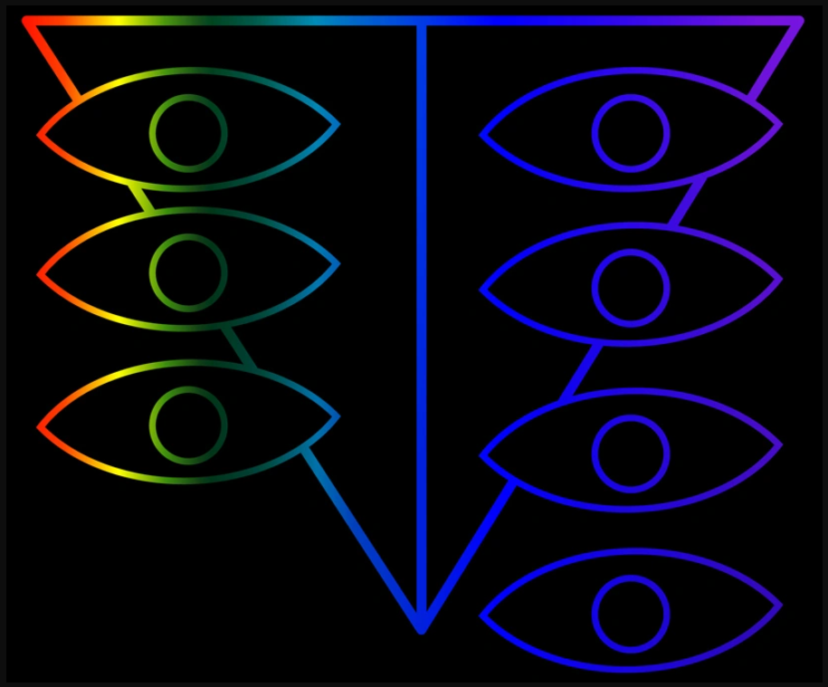

# `techne:seele`

{ width="220" }

Put a decision to a panel of models instead of one. Every seat answers the same brief alone, the pooled answers are ranked blind, and a chair that holds no seat rules. The report shows the vote, the pick, the strongest objection to it, and every dissent.

Part of [techne](../plugins/techne.md): `/plugin install techne@techne`, then `/techne:setup`.

## When to use

- A title, a name, the wording of a claim, a choice between designs: a judgment call where one model's answer changes when you ask again.
- A review of a paper, proposal or design note before it goes out, where you want to know which changes every reviewer wants and which only one does.
- Any time you would otherwise ask two models and compare by eye.

Not for code review ([`techne:elenchus`](elenchus.md) runs the code; a panel only reads) and not for a question a test or a document can answer.

## Usage

```
/techne:seele a title for my talk on flaky tests (abstract below)
/techne:seele review docs/proposal.md against the call's criteria
```

Or ask in words: "convene SEELE on this", "put these three names to a panel". Typing SELEE works too.

Claude writes one self-contained brief, tells you which models will sit, and runs two rounds:

1. **Blind proposals.** Each seat gets the brief and no list of options. If you already have candidates, they join the pool afterwards, unnamed.
2. **Blind ranking.** Each seat ranks the pooled candidates. Authors are hidden, each ballot has its own order and its own labels, and no seat sees another seat's answer.

A chair then reads the brief, the vote and every ballot's reasons, without knowing which model said what, and picks. The chair is Fable where the account has it, otherwise Opus, and it holds no seat.

## The report

```text
┌──────────┐ ┌──────────┐ ┌──────────┐ ┌──────────┐ ┌──────────┐
│ SEELE 01 │ │ SEELE 02 │ │ SEELE 03 │ │ SEELE 04 │ │ SEELE 05 │
│  SOUND   │ │  SOUND   │ │  SOUND   │ │  SOUND   │ │    NO    │
│   ONLY   │ │   ONLY   │ │   ONLY   │ │   ONLY   │ │  SIGNAL  │
└──────────┘ └──────────┘ └──────────┘ └──────────┘ └──────────┘
```

Under the monoliths: which model held each seat, the pick and the chair's reasons, the vote table, the strongest objection to the pick, and each seat that disagreed with its reason. When the chair picks against the vote, the report says so in bold and lists the vote as the first dissent. When a lead depends on a seat voting for its own proposal, or every seat comes from one model family, a flag says that too. [A full example](https://github.com/ajbarea/techne/blob/main/plugins/techne/skills/seele/references/report.md#an-example).

## Seats

Claude Code alone is enough: Opus and Sonnet always sit, and Haiku joins when no other model is available. When the `agy` or GitHub Copilot CLI is installed, each takes a seat, so the panel spans more than one model family. A local Ollama model or any other command-line model sits when you name it. `agy` and Copilot run read-only in an empty folder and receive only the brief and the candidates. Ollama and any command you name run as you wrote them, with the same page on stdin.

Seats that send the brief to another vendor are named before the panel opens. Ask for a Claude-only panel to keep a private brief inside your Claude session.

## Why it works this way

Each rule answers a measured bias of model judges: position in a list, option letters, longer answers, a model's preference for its own text, and the shared mistakes of models from one family. [The sources](https://github.com/ajbarea/techne/blob/main/plugins/techne/skills/seele/references/research.md) list the paper behind each rule.

SEELE is the council of monoliths in *Neon Genesis Evangelion*. The skill keeps the staging and drops the secrecy: every ballot is on the record.

## See also

- [`techne:elenchus`](elenchus.md): adversarial review of a code change, which reproduces and traces instead of voting.
- [`techne:research-grounded`](research-grounded.md): grounds a decision in sources; do that first when the panel needs facts.

## Full instructions

[`SKILL.md` on GitHub](https://github.com/ajbarea/techne/blob/main/plugins/techne/skills/seele/SKILL.md) holds the full instructions Claude follows for this skill.
